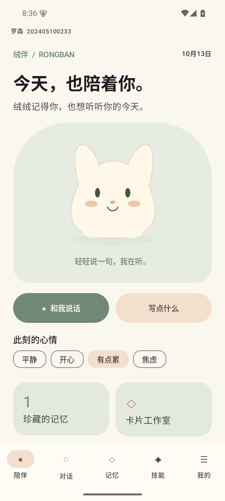
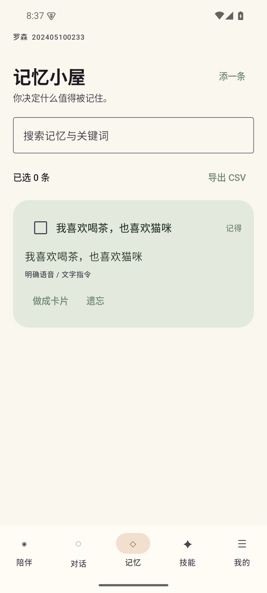
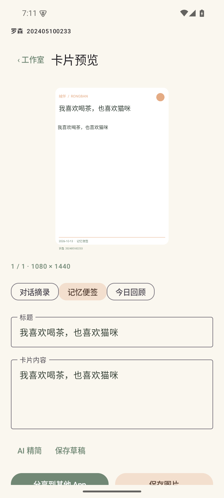

<div align="center">
  
  <h1>绒伴 Rongban</h1>
  <p><strong>把值得记住的小事，留给一只有记忆的语音桌宠。</strong></p>
  <p>原生 Android · 情境记忆 · 离线语音 · 分享卡片</p>
  <p>
    
    
    
  </p>
  <p><a href="#开始使用">开始使用</a> · <a href="#功能">功能</a> · <a href="#从源码构建">源码构建</a> · <a href="#开源与许可">开源与许可</a></p>
</div>

## 一只记得你的桌宠

绒伴是一款原生 Android AI 语音助手。你可以用文字或语音与它交流，保存自己的偏好与近况；想留住一句话时，再把它做成一张卡片。

安装一个 APK 后，桌面会出现「绒伴」和「绒伴卡片」两个入口。后者可以独立启动，读取主应用的数据并完成卡片制作。

<div align="center">
  
  
  
  <br><sub>真实模拟器界面：陪伴首页 · 记忆小屋 · 卡片预览</sub>
</div>

## 功能

| | 能做什么 |
| --- | --- |
| **语音与桌宠** | 本地中文语音识别和朗读；悬浮桌宠可拖动、贴边、暂停和关闭。拒绝麦克风或悬浮权限后，仍可在应用内使用文字功能。 |
| **情境记忆** | 对它说「记住我喜欢喝茶」可直接保存；AI 提取的事实和摘要需确认后才参与跨会话引用。记忆可以查看来源、编辑、停用或删除。 |
| **主动技能** | 内置记忆、回忆、专注、今日回顾、生成卡片和鼓励陪伴；也可导入 `SKILL.md` 提示技能。自定义技能由用户主动选择，不执行脚本或自主操作手机。 |
| **卡片与导出** | 从记忆或对话创建卡片，选择模板、编辑和预览；单页保存为 PNG，长文分页保存为 ZIP，或通过系统面板分享。记忆列表支持 CSV 导出。 |

本地完成语音识别、朗读、常用指令、存储和卡片导出；自由聊天、自动提取与内容总结需要连接模型服务。

## 开始使用

**设备要求：** Android 10 或以上；离线语音支持 ARM64 和 x86_64。主要验收环境为 Android 15 模拟器。

1. [下载演示 APK](https://github.com/bei666qi-pan/rongban-android/releases/download/v0.1.0-course/rongban-0.1.0.apk)（包含离线模型），或前往 [发布页](https://github.com/bei666qi-pan/rongban-android/releases) 查看其他文件。你也可以按下方步骤自行构建。模型权重的授权状态请查看 [第三方来源与许可](THIRD_PARTY.md)。
2. 打开「绒伴」，选择「写点什么」开始文字交流，或选择「和我说话」并授权麦克风。首次准备语音模型需要数秒；出现「正在听」后再说话，识别结果可修改后发送。
3. 试试「记住我喜欢喝茶」「回忆喝茶」或「开始专注一分钟」。在「记忆」管理保存的内容，在「技能」选择或导入技能。
4. 如需自由聊天或 AI 总结，在「我的」配置服务协议、Base URL、模型名称和 API Key。默认配置为 MiMo Token Plan；也支持兼容 Chat Completions、Anthropic 和 Gemini 的协议。安装包不预置 API Key。
5. 在应用内进入「卡片工作室」，或从桌面直接打开「绒伴卡片」，选择内容后编辑、保存或分享。

悬浮桌宠需要在「我的」主动开启并授予悬浮权限；持续通知中提供暂停和关闭入口。

## 数据与隐私

对话、记忆、技能和草稿保存在设备本地；API Key 使用 Android Keystore 加密保存。在线聊天或总结时，应用会向你配置的模型服务发送完成请求所需的对话与情境；启用记忆时，相关记忆也可能作为上下文发送。请根据所选服务的隐私政策决定是否使用联网功能。

删除记忆后，它不再用于跨会话引用；原始对话需要在对话列表中单独删除。语音识别结果可能出现误字，建议发送前检查。

## 从源码构建

需要 **JDK 17 或 21、Android SDK 35、Python 3.12 或以上** 和可访问上游资源的网络。语音运行时及模型不提交到 Git；准备脚本下载固定版本并校验 SHA-256，模型体积较大，请预留下载与构建空间。

```sh
git clone https://github.com/bei666qi-pan/rongban-android.git
cd rongban-android
python3 scripts/prepare_speech.py
./gradlew assembleDebug
```

安装包生成于 `app/build/outputs/apk/debug/`。也可以用 Android Studio 打开项目，在准备完语音资源后运行 `app`。

运行基础检查与已连接设备测试：

```sh
./gradlew testDebugUnitTest lintDebug
./gradlew :app:connectedDebugAndroidTest
```

设备测试需要已启动的兼容模拟器或 Android 设备。真实模型服务联调需自行配置凭证；CI 不注入真实 API Key。[验收报告](docs/验收报告.md)记录了验证范围和已知限制。

## 项目结构

```text
app/          陪伴界面、对话、技能、设置、桌宠与提醒
core/         本地数据、语音、记忆检索、模型协议与卡片渲染
cards/        独立卡片入口、编辑、导出与分享
examples/     可导入的 SKILL.md 示例
docs/         开发文档、验收报告与界面记录
third_party/  上游版本、模型来源与校验信息
```

应用使用 Kotlin、Jetpack Compose、ViewModel、协程与 Flow、Hilt、Room 和 DataStore；本地语音基于 [sherpa-onnx](https://github.com/k2-fsa/sherpa-onnx)，技能解析与模型协议参考并适配 [RikkaHub](https://github.com/rikkahub/rikkahub)。项目中的六组阶段性 PR 按依赖顺序维护，历史 PR 尚未合并，可在 [Pull requests](https://github.com/bei666qi-pan/rongban-android/pulls) 查看。

## 开源与许可

项目代码采用 [AGPL-3.0](LICENSE)。第三方代码、模型及测试音频各有独立来源和许可；特别是中文 ASR 模型权重的许可尚待确认。复用或再分发前，请查阅 [THIRD_PARTY.md](THIRD_PARTY.md) 与上游说明。
